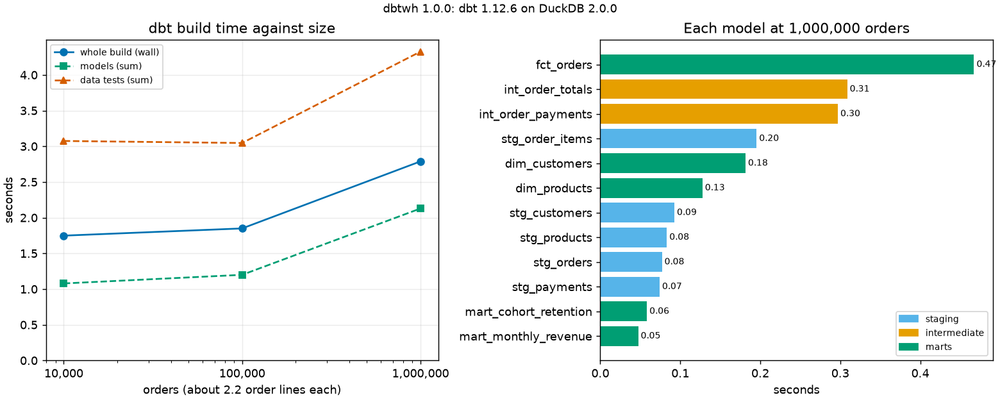

# dbtwh: a small warehouse with dbt and DuckDB, checked against an independent calculation

[](https://github.com/TexAlphaWolf/ana-dbt-duckdb-warehouse/actions/workflows/ci.yml)
[](https://github.com/TexAlphaWolf/ana-dbt-duckdb-warehouse/actions/workflows/codeql.yml)


A dbt project on DuckDB that turns the raw files of an online shop (customers, products, orders, order lines, payments)
into a layered warehouse: staging views, intermediate tables and five marts. The raw data is **generated with the faults a
real source has** (customers delivered as change records, status typed in any case, duplicated orders and payments, failed
payments), and every mart is then **compared, column by column, with a calculation done in NumPy from the clean data**,
which uses no SQL and no dbt. A command line (`dbtwh`) generates, builds, verifies and benchmarks it, with tests, a Docker
image and a report generated from the measured numbers.



## What the numbers say

All figures are from one run in Docker on Linux x86_64 with 12 CPUs, Python 3.14.10, dbt-core 1.12.6, dbt-duckdb 1.11.1 and
DuckDB 2.0.0 ([`docs/bench.json`](docs/bench.json); seed 1, 4 threads; each time is the median of 5 builds).

1. **The whole warehouse builds and passes 66 of 66 checks at every size.** 12 models, 49 data tests and 5 unit tests, from
   10,000 orders (44,573 raw rows) to 1,000,000 orders (4,438,827 raw rows). After each size, all 31 column comparisons with
   the independent calculation match.
2. **1,000,000 orders build in 2.79 s**, against 1.75 s for 10,000: 99.6 times the rows for 1.59 times the time. Most of
   a small build is fixed cost (starting the models and the tests), not data.
3. **The tests cost more than the models.** At 1,000,000 orders the 12 models take 2.13 s (summed), the 49 data tests 4.33 s
   and the 5 unit tests 1.06 s; the tests run in parallel, so the run takes 2.79 s. Data tests are 57.6% of the node time
   there and 59.8% at 10,000 orders.
4. **Where the model time goes.** Staging models are views and take 0.54 s at every size; the work is in the intermediate
   tables (0.16 s to 0.61 s) and the marts (0.27 s to 0.90 s). The slowest model at 1,000,000 orders is `fct_orders`, 0.47 s.
5. **Size on disk.** The warehouse file is 90.5 MiB at 1,000,000 orders, 2.1 times the 42.3 MiB of compressed Parquet it was
   built from, because it holds the intermediate tables and the marts as well.

[`docs/analysis.md`](docs/analysis.md) goes through the results and their limits; [`docs/bench.md`](docs/bench.md) is the
generated report; [`docs/architecture.md`](docs/architecture.md) describes the layers.

## Quick start

With Docker (nothing else to install):

```bash
docker build -t dbtwh .
docker volume create wh
docker run --rm --user 0 -v wh:/data --entrypoint chown dbtwh 10001 /data
RUN="docker run --rm --read-only --tmpfs /tmp --cap-drop ALL --security-opt no-new-privileges --network none -v wh:/data dbtwh"
$RUN generate --orders 10000 --seed 1 --out /data/raw        # five Parquet files and a manifest
$RUN build --raw /data/raw --db /data/wh.duckdb --workdir /data/work --docs
$RUN verify --raw /data/raw --db /data/wh.duckdb             # 31 checks against the independent calculation
```

With Python 3.11 to 3.14:

```bash
pip install .
dbtwh demo --orders 10000 --seed 1 --out demo     # generate, build and verify in one go
```

`build --docs` also writes one HTML page with the lineage graph and every description (`WORKDIR/target/static_index.html`).
`dbtwh project DIR` copies the dbt project out of the package, to read it or to run dbt on it by hand.

## Real output

`dbtwh demo --orders 10000 --seed 1 --out demo` (the 31 `ok` lines, one per compared column, are left out here):

```text
1,519 customers, 200 products, 10,099 orders, 21,946 order_items, 10,809 payments
dbt build: 12 models, 49 data tests, 5 unit tests: 66 passed, 0 failed, in 1.7 s
31 of 31 checks match the independent calculation
```

The time on the build line changes from run to run.

## The data and its faults

A shop from 2024-01-01 to 2025-12-31. Customers order with a power-law weight (a few order often, many once), products have
a price and a cost, orders have one to five lines, and payments can be split or partial. The raw files then carry:

| Fault | What the warehouse does |
|---|---|
| A customer arrives as one to three versions | keeps the latest (`stg_customers`) |
| Status as `Completed`, ` SHIPPED `, `canceled` | one of four spellings (`clean_status` macro) |
| 1% of orders appear twice | one row per order |
| 0.5% of payments appear twice | each payment counted once |
| Failed payment attempts | not money received |

Money is an integer number of cents throughout, so totals do not depend on the order of the additions. Details in
[`docs/method.md`](docs/method.md).

## Commands

| Command | What it does |
|---|---|
| `dbtwh generate --orders N --seed S --format parquet\|csv --out DIR` | The five raw files and `manifest.json` |
| `dbtwh build --raw DIR [--db FILE] [--workdir DIR] [--threads N] [--docs]` | `dbt build`: models, data tests and unit tests; exit 1 if any fails |
| `dbtwh verify --raw DIR [--db FILE]` | Compares every mart with the independent calculation; exit 1 on a difference |
| `dbtwh demo [--orders N] [--out DIR]` | Generate, build and verify |
| `dbtwh bench --sizes A,B,C --repeat R --out DIR` | Build time for growing sizes, with a verification after each; writes `bench.json`, `bench.md`, `summary.png` |
| `dbtwh render FILE.json [-o FILE.md] [--figure FILE.png]` | Rebuilds the Markdown (and the figure) from `bench.json` |
| `dbtwh project DIR` | Copies the dbt project to a folder |

Exit codes: 0 success, 1 a failed dbt node or a mismatch, 2 an error (missing files, bad options).

## What is checked

- **49 data tests**: `unique`, `not_null`, `accepted_values`, `relationships`, a custom `non_negative`, and five singular
  tests that state a business rule as a query that must return nothing (revenue is the same in every mart; no order is
  overpaid; a cancelled order has no money; a cohort is 100% active in its first month; nobody orders before signing up).
- **5 unit tests**: a model is run on a few rows written in the test, without reading any file.
- **An enforced contract** on `fct_orders`: dbt checks its column names and types before building it.
- **The independent calculation** (`truth.py`, `verify.py`): 31 column-by-column comparisons. `tests/test_build.py` shows
  that it can fail: a changed number in the warehouse is reported, and raw data with a missing product or a negative quantity
  makes the dbt tests fail.

## Development

```bash
pip install -e ".[dev]"
ruff check . && ruff format --check . && mypy && pytest --cov
```

CI runs this on Python 3.11 to 3.14, again on 30,000 orders with another seed, on Windows and macOS, builds the Docker image
and runs the end-to-end scripts (`tools/docker_e2e.sh`, and `tools/docker_e2e.ps1` from PowerShell). `tools/run_full.ps1`
produces the measurements in this README.

## Limits

Synthetic data, one engine (DuckDB, one file, one machine), full rebuilds only (no incremental models or snapshots), and an
independent calculation that shares the generator's business rules: it catches mistakes in the SQL, not a wrong rule. See
[`docs/limitations.md`](docs/limitations.md).

MIT license.
